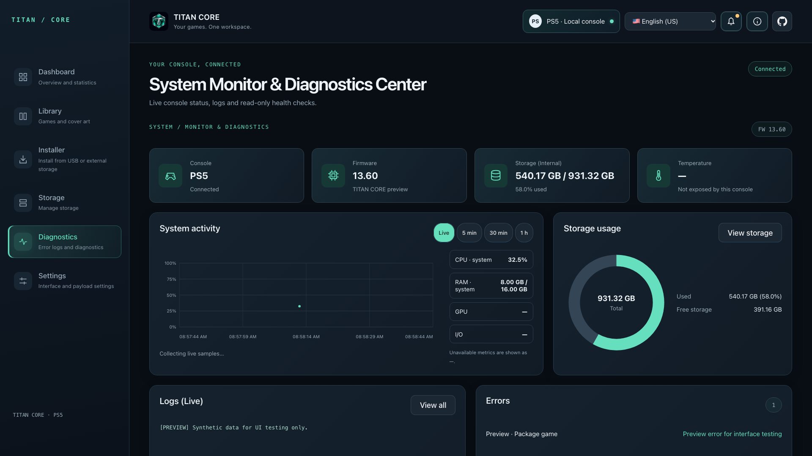

<p align="center"></p>
<h1 align="center">TITAN CORE</h1>
<p align="center">A PS5 game workspace with a native FPKG engine, external-drive installer and live diagnostics.</p>

TITAN CORE combines a web interface, the native game-mounting workflow derived from Kraken Mount, kstuff-lite 1.11 and ShadowMountPlus 1.7beta10. It targets jailbroken PS5 consoles with elfldr. The development console uses firmware 13.60; wider hardware compatibility has not been established. This project does not include a console exploit.

[Releases](https://github.com/devchmod/TITAN-CORE/releases) · [Source](https://github.com/devchmod/TITAN-CORE) · [Credits](CREDITS.md)

## Features

- Dashboard and game library for supported debug FPKGs, folders and image sources, including exFAT.
- USB/extended-drive browser, internal FPKG copy with progress, byte-for-byte verification and cancellation.
- Rename-only import of supported installed packages from `/user/app` into the homebrew workflow.
- Reported system/payload CPU and memory, storage, live logs, kernel-log viewer and current alerts.
- Browser-local CPU history, read-only reported health checks, JSON/CSV exports and print/Save PDF reports.
- 31 console-language/regional choices, flag cues, Arabic RTL, themes and controller-friendly navigation.


*Interface preview with synthetic data. Unsupported sensors remain unavailable on the actual console.*

## Use

1. Close games before loading a new payload.
2. Send the release ELF through your existing elfldr workflow.
3. Open `http://<PS5-IP>:8097` from the console or a browser on your Mac/PC/phone.
4. Browse Library or open Installer to choose a supported PS5 debug FPKG from a mounted USB/extended drive.

Installer copies one complete PKG internally and keeps the external original. The native engine then builds its cache, registers the game and mounts its content at launch. This is the homebrew/debug-FPKG workflow, not a general retail/encrypted PKG installer. Cache takes extra space and can be substantial for incompatible block layouts. Moving a supported existing `/user/app` package uses rename only; if direct movement is unavailable, its source stays in place without creating another full package.

Do not disconnect a source drive during installation. Ordinary cancellation/errors clean the transaction's partial copy; power loss may leave a reserved `.part` directory that needs inspection before retrying. Resume and update/DLC merging are not implemented.

## Diagnostics and localization

Metrics are reported by the console, with payload-only fallbacks labeled explicitly. Temperature/GPU/I/O rate are not exposed by this backend and remain unknown. CPU history starts when the page opens; it is not historical console telemetry. Diagnostic checks inspect reported status only and are not hardware stress tests. Reports/history are handled in the browser.

English, French, Arabic, Simplified Chinese and German have full current catalogs. Additional languages currently translate 50 core labels and use English fallback for remaining technical text. See [coverage](Localizations/coverage.json).

## Build

The source uses Rust 1.99.0 and PS5 payload SDK 0.43 in the Docker build. Keep compiler parallelism at two jobs.

```sh
TITAN_UNIFIED_STACK=1 bash ps5/build.sh
```

The build verifies bundled runtime/service hashes and builds both ELF stages. Internal crate/toolchain names retain upstream compatibility; the user-facing application is TITAN CORE. See [architecture](DESIGN.md), [validation](docs/VALIDATION.md) and [credits](CREDITS.md).

## License and credits

GPL-3.0-or-later. TITAN CORE is a derivative/aggregate project, with original authorship and upstream notices retained. The display name `chmod v0.1` applies to a custom AMPR 0.4.0 launch-notice build; it does not claim a new upstream runtime or authorship of that engine. Bundled component source snapshots, modified runtime source and notices are included under `vendor/`.

See [CREDITS.md](CREDITS.md), [LICENSE](LICENSE) and [THIRD_PARTY_NOTICES](THIRD_PARTY_NOTICES).
